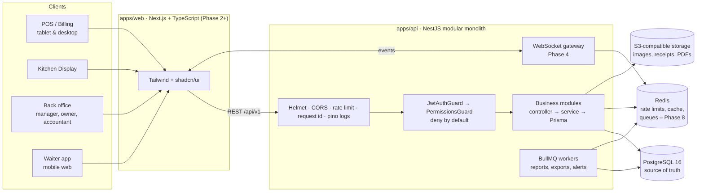
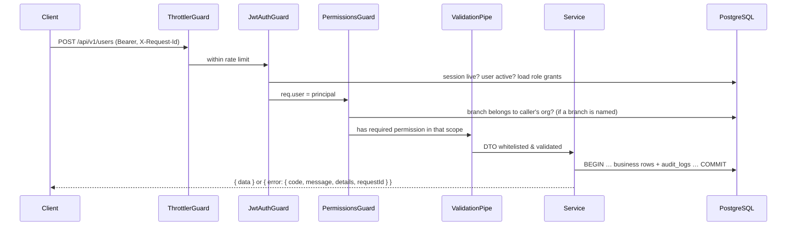
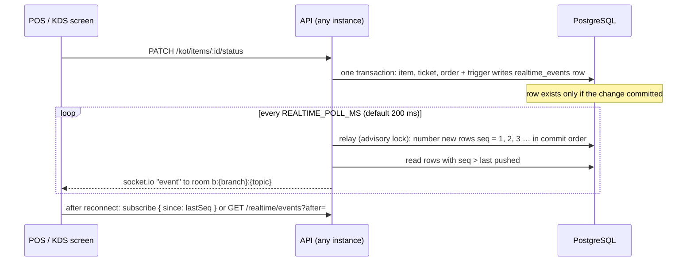

# RestaurantOS – Architecture

RestaurantOS is a restaurant ERP and POS for Indian restaurants: dine-in, takeaway and delivery
billing, KOT/kitchen display, GST invoicing, inventory with recipes, purchasing, expenses, staff,
cash shifts and reporting, across multiple branches.

This document covers the system design and the decisions behind it. The database is described in
[database.md](./database.md), the HTTP API in [api-contracts.md](./api-contracts.md), and the
progress against the specification in [requirements-checklist.md](./requirements-checklist.md).

## 1. System overview



* **Modular monolith.** One deployable API with strict module boundaries. Each module owns its
  tables and exposes a service; other modules call that service, never its tables directly. Any
  module can later be extracted behind the same service interface.
* **PostgreSQL is authoritative.** Every number shown anywhere (dashboard, POS totals, KDS state)
  is derived from database rows. Redis and WebSockets are accelerators and notification paths;
  losing them never loses data.
* **The backend computes money.** The frontend sends intent (product, variant, quantity, discount
  request). The API loads prices from the database, applies tax rules and rounding, and persists
  the result. Totals sent by a client are ignored.

## 2. Repository layout

```
restraunt-erp/
├── apps/
│   ├── api/                     NestJS API (this phase)
│   │   ├── prisma/
│   │   │   ├── schema.prisma    canonical schema (all modules)
│   │   │   ├── migrations/      SQL migrations, incl. hand-written integrity rules
│   │   │   └── seed.ts          reference data + optional demo organization
│   │   ├── src/
│   │   │   ├── config/          zod-validated environment
│   │   │   ├── common/          guards, decorators, error filter, envelope, pagination
│   │   │   ├── prisma/          PrismaService
│   │   │   └── modules/         one folder per business module
│   │   └── test/                integration tests against a real PostgreSQL
│   └── web/                     Next.js frontend (Phase 2+)
├── docs/
├── docker-compose.yml
└── .github/workflows/ci.yml
```

## 3. Backend modules

Each module has controller → service → data access (Prisma), DTOs with class-validator, an
authorization policy on every route, and tests. Controllers only translate HTTP to service calls.

| Module | Phase | Owns tables | Responsibility |
|---|---|---|---|
| auth | 1 ✅ | sessions, refresh_tokens, password_reset_tokens | Login, refresh rotation, logout, password reset/change |
| rbac (roles & permissions) | 1 ✅ | roles, permissions, role_permissions, user_roles | Permission catalog, default roles, custom roles, effective permissions |
| users | 1 ✅ | users | Accounts, role assignment with anti-escalation |
| organizations / branches | 1 ✅ | organizations, branches, branch_settings | Tenant and outlet details, GSTIN, state codes |
| audit | 1 ✅ | audit_logs | Append-only record of sensitive actions |
| menu, categories, products | 2 ✅ | categories, products, product_variants, modifier_groups, modifiers, branch_product_prices, combo_items | Menu, variants, add-ons, branch pricing |
| tables | 2 ✅ | restaurant_tables, table_sessions | Floor plan, occupancy, transfer/merge |
| orders, order items | 3 ✅ | orders, order_items, order_item_modifiers, order_status_history | Order lifecycle state machine |
| billing, invoices, payments, taxes, discounts | 3 ✅ | invoices, invoice_items, payments, payment_allocations, refunds, credit_notes, tax_rates, discounts, applied_discounts, document_sequences | GST computation, invoice numbering, split/partial payments, refunds |
| kot | 4 ✅ | kitchen_stations, kitchen_tickets, kitchen_ticket_items | Kitchen tickets per station, item-level status |
| notifications / realtime | 4 ✅ | notifications | WebSocket gateway, event outbox |
| inventory, recipes, stock movements | 5 ✅ | units, ingredients, inventory_balances, stock_movements, stock_adjustments, wastage_records, recipes, recipe_items | Ingredient ledger, BOM deduction |
| suppliers, purchase orders | 5 ✅ | suppliers, purchase_orders, purchase_order_items, goods_receipts, goods_receipt_items, supplier_invoices, supplier_payments | Purchasing and receiving |
| expenses | 6 | expense_categories, expenses | Expense records |
| employees, attendance | 6 | employees, attendance, employee_shifts | Staff profiles, attendance |
| shifts (cash) | 6 | cash_sessions, cash_movements | Drawer open/close and reconciliation |
| reports | 7 | (read models) | Sales, GST, P&L, inventory, exports |
| idempotency | 3 ✅ | idempotency_keys | Replay-safe POSTs |

The whole schema is created in Phase 1 so relationships are designed once; later phases add
services and, where needed, additive migrations.

## 4. Request lifecycle



* **Deny by default.** A route without `@Public()`, `@AuthenticatedOnly()` or
  `@RequirePermissions()` returns 403, so a new endpoint cannot be left open by accident.
* **Server-side session check on every request.** Access tokens are short-lived (15 min), and the
  guard also checks that the session is not revoked, so logout, deactivation, password reset and
  refresh-token theft take effect immediately.
* **Permissions are read fresh on each request.** Changing a role's permissions applies on the
  next call without waiting for tokens to expire. (A short Redis cache keyed by user and a
  permission version can be added if this becomes a hotspot; it is one indexed query today.)

## 5. Multi-tenancy and branch isolation

* Every restaurant-owned row has `organization_id`, and `branch_id` where it belongs to an
  outlet. Branch-owned tables reference `branches (id, organization_id)` with a **composite
  foreign key**, so the database itself refuses a row whose branch belongs to a different
  organization. `user_roles` does the same for roles and users.
* Services always filter by the caller's `organizationId` from the verified session, never from
  client input.
* A branch named in a request (path `:branchId`, `?branchId=`, body `branchId` or the
  `X-Branch-Id` header) is validated against the caller's organization first. Unknown and
  foreign branches both return **404**, so other tenants' ids are not confirmed.
* Role assignments are either organization-wide (`branch_id NULL`) or for one branch. A branch
  manager's permissions apply only to their branch; acting on a user requires the permission in
  every branch where that user has a role.

## 6. Authentication

| Item | Choice |
|---|---|
| Passwords | Argon2id (19 MiB, t=2, p=1, OWASP baseline). Policy: 10–128 chars, letters and digits. |
| Access token | JWT HS256, 15 min, `iss`/`aud` checked, `alg` pinned, carries `sub`, `org`, `sid`. |
| Refresh token | 256-bit random opaque token, only its SHA-256 stored. 7-day TTL, capped by a 30-day absolute session lifetime. |
| Rotation | Every refresh issues a new token and marks the old one used (compare-and-set, so two concurrent refreshes cannot both win). |
| Reuse detection | Presenting an already-rotated token revokes the entire session and is audited as `auth.refresh_token_reuse`. |
| Browser storage | Refresh token in an `HttpOnly; SameSite=Strict; Secure (prod); Path=/api/v1/auth` cookie. Access token kept in memory by the SPA. |
| CSRF | Cookie is only sent to `/api/v1/auth/*`, is SameSite=Strict, and cookie-based refresh/logout also require an allowed `Origin`. All other endpoints use the `Authorization` header, which browsers never attach automatically. |
| Native/POS clients | May send the refresh token in the JSON body instead of the cookie. |
| Brute force | Per-IP `auth` rate-limit bucket on login/refresh/reset, plus account lockout after 5 failures for 15 minutes. Unknown emails take the same time and return the same error. |
| Password reset | Single-use, 30-minute token emailed as a link; only its hash is stored; the response never reveals whether the email exists; a reset revokes every session. |

## 7. Authorization (RBAC)

* **Permission catalog** (`src/modules/rbac/permissions.catalog.ts`): 73 stable codes such as
  `orders.cancel`, `billing.discount.override`, `refunds.approve`, `menu.price.update`.
* **Default roles** per organization: Super Admin, Restaurant Owner, Manager, Cashier, Waiter,
  Kitchen Staff, Inventory Manager, Accountant. Their permissions are editable (except Super
  Admin, which always holds every permission including future ones). Organizations can add
  custom roles.
* **Sensitive operations have their own permissions** so they can be granted narrowly:
  discounts within the cashier limit vs. above it, refund initiation vs. approval, cancellation,
  reopen, price override, menu price change, credit notes.
* **Anti-escalation.** You can only grant, or take away, permissions you hold yourself in that
  scope. Only a Super Admin can grant Super Admin. The last active Super Admin cannot be removed
  or deactivated.
* **Every change is audited** with before/after values and the actor.

## 8. Financial integrity (design for Phase 3, enforced in the schema now)

* Money is `NUMERIC(14,2)` in PostgreSQL and `Prisma.Decimal` (decimal.js) in code. No floats.
* `order_items` snapshot name, HSN/SAC, unit price, tax rate and every computed amount, so later
  menu changes never alter past orders.
* Invoice numbers come from `document_sequences`, locked with `SELECT … FOR UPDATE` inside the
  invoice transaction, giving gap-free unique numbers per branch, series and financial year
  (`INV/2026-27/000123`). Unique indexes back this up.
* **Finalized invoices are immutable in the database**: a trigger rejects any change to their
  amounts, items, number or date, and rejects deleting them. Only payment progress may change.
  Corrections go through credit notes.
* `audit_logs`, `stock_movements`, `order_status_history` and `cash_movements` are append-only,
  enforced by triggers.
* Check constraints cover: non-negative amounts, discount ≤ subtotal, paid ≤ total, refunded ≤
  paid, CGST = SGST and CGST+SGST = IGST = rate, intra-state invoices have no IGST and
  inter-state ones no CGST/SGST, cancelled orders carry a reason and actor, stock movement sign
  matches its type, closed cash sessions carry a full reconciliation.
* `idempotency_keys` (org, scope, key, request hash, stored response) make payment, order
  submission and invoice creation safe to retry; `payments`/`refunds` also have a unique
  `(organization_id, idempotency_key)`. `stock_movements.dedupe_key` makes each business event
  deduct stock at most once.
* GST: CGST+SGST when the place of supply is in the branch's state, IGST otherwise, with HSN/SAC
  on every line. Tax rates and rounding must be validated with a chartered accountant before
  production use.

## 9. Real-time (Phase 4)



- **Outbox in the database.** Triggers on `orders`, `restaurant_tables`, `kitchen_tickets`,
  `kitchen_ticket_items`, `payments` and `refunds` write a `realtime_events` row in the same
  transaction as the change, so a committed change is never lost and a rolled-back one is never
  sent. Several changes to one record in one transaction are merged into one event with the final
  state.
- **Numbering.** The relay gives committed rows a gap-free `seq` under a PostgreSQL advisory lock,
  so numbers follow commit order even with several API instances. Every instance then reads rows past
  the last `seq` it pushed and sends them to its own sockets. No Redis is needed for fan-out; the
  socket.io Redis adapter can be added later without changing clients.
- **Authorization.** The socket.io handshake (`path: /realtime`, `auth.token`) checks the access token
  and session like a REST call. `subscribe { branchId }` joins only the topics the caller may read in
  that branch: `orders` (orders.read), `kitchen` (kot.read), `tables` (tables.read), `payments`
  (payments.read), `inventory` (inventory.read). The socket is closed when the token expires (`session_expired`) and within a
  minute of the session being revoked.
- **Recovery.** Each event carries `id` (= `seq`), the entity id and, where it has one, its
  `version`. Clients ignore ids they already processed. After a reconnect they subscribe with
  `since` (or call `GET /realtime/events?after=`) and get the missed events, or `RESYNC_REQUIRED`
  when the gap is older than `REALTIME_RETENTION_HOURS`, in which case they reload through REST
  (`GET /orders?updatedSince=`, `GET /kot?updatedSince=`, the floor plan).
- **Source of truth.** Events say what changed with a small summary; screens read details through
  the REST API. PostgreSQL stays authoritative.

## 9a. Inventory (Phase 5)

- **Ledger first.** Every stock change is one row in `stock_movements` (append-only, enforced by a
  trigger) carrying a unique `dedupe_key` for the business event that caused it, and the branch
  balance after it. `inventory_balances` holds the running quantity and weighted average cost and
  is updated in the same transaction under a row lock, so the balance always equals the sum of the
  ledger and parallel changes queue up.
- **Sales.** Order changes call `syncOrderConsumption`, which works out what the order should have
  consumed under the branch's `stockDeductionPolicy` and posts only the difference. Repeating a call
  changes nothing; reopening or voiding reverses. Refunds with restock post reversals keyed by the
  credit note line.
- **Purchasing.** Goods receipts post `PURCHASE_RECEIPT` movements at the price before GST (input
  tax credit) converted to the base unit; the purchase order row is locked while a delivery is
  recorded so two deliveries cannot over-receive. Supplier bills and payments lock the bill row.
- **Alerts.** A trigger on `inventory_balances` emits `inventory.low_stock` / `inventory.restocked`
  through the realtime outbox only when the minimum level is crossed, and writes a notification.

Rules in plain words: [inventory.md](inventory.md).

## 10. Errors, logging and observability

* Responses: `{ data }` or `{ data, meta }` for lists; errors: `{ error: { code, message,
  details?, requestId } }`. Stack traces, SQL and constraint internals are logged, never returned.
* Structured JSON logs (pino) with a request id (taken from `X-Request-Id` or generated),
  user id, and redaction of `Authorization`, cookies and `Set-Cookie`.
* `/api/v1/health/live` and `/api/v1/health/ready` (checks PostgreSQL) for orchestrators.

## 11. Architecture decision records

| # | Decision | Why |
|---|---|---|
| ADR-1 | Modular monolith, NestJS + Prisma + PostgreSQL | One deploy, real transactions across modules, clear boundaries for later extraction. |
| ADR-2 | Integrity rules in the database as well as in services | A bug in one service must not be able to corrupt invoices, stock or audit history. |
| ADR-3 | Organization-scoped roles, branch-scoped assignments | Fits chains where staff work at one outlet and owners/accountants see all. |
| ADR-4 | Opaque, hashed, rotating refresh tokens with reuse detection | Stolen refresh tokens are detected; database leaks don't reveal usable tokens. |
| ADR-5 | Strict refresh (no grace window) | A retried refresh after a lost response signs the device out. Chosen for security; revisit if POS tablets on poor networks are affected. |
| ADR-6 | Actor columns (`created_by_id` etc.) are not foreign keys | Keeps history rows independent of user lifecycle; users are soft-deleted, never removed. |
| ADR-7 | Entire schema designed in Phase 1 | Relationships across billing, inventory and purchasing are decided once; later phases add behaviour. |
| ADR-8 | class-validator for request DTOs, zod for environment | Native Swagger integration for DTOs; zod gives fail-fast config parsing. |
