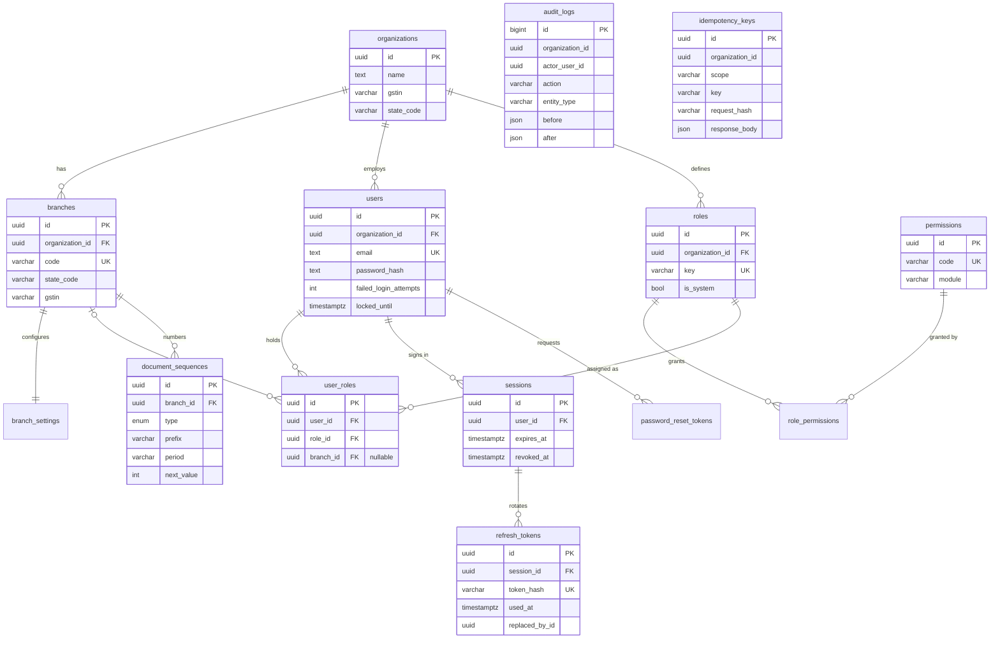
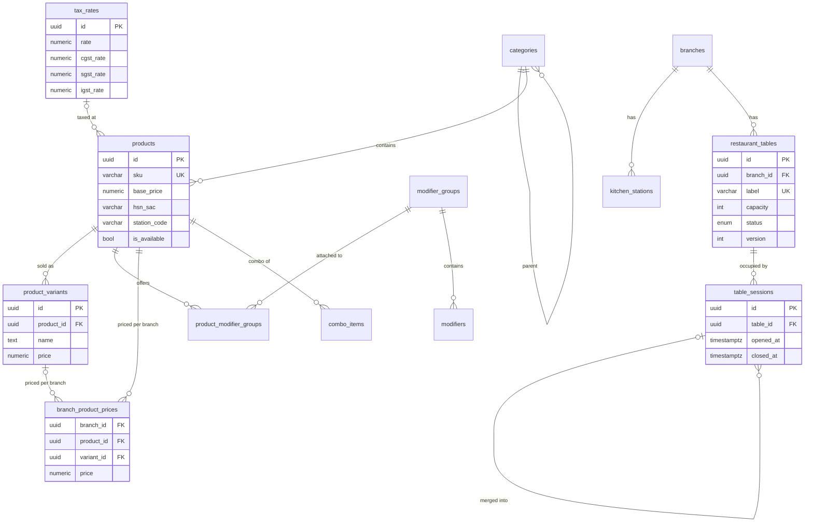
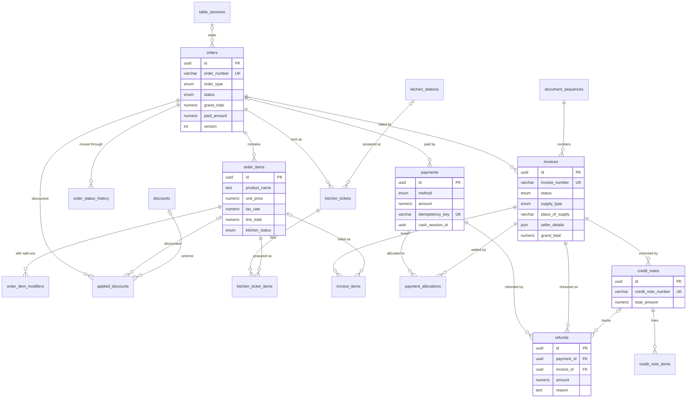
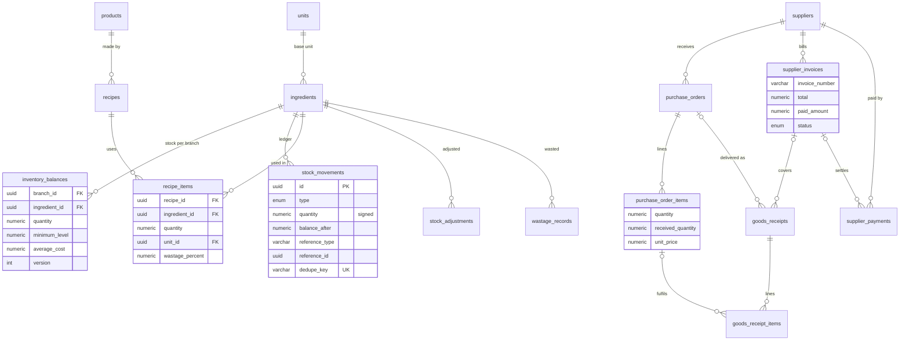
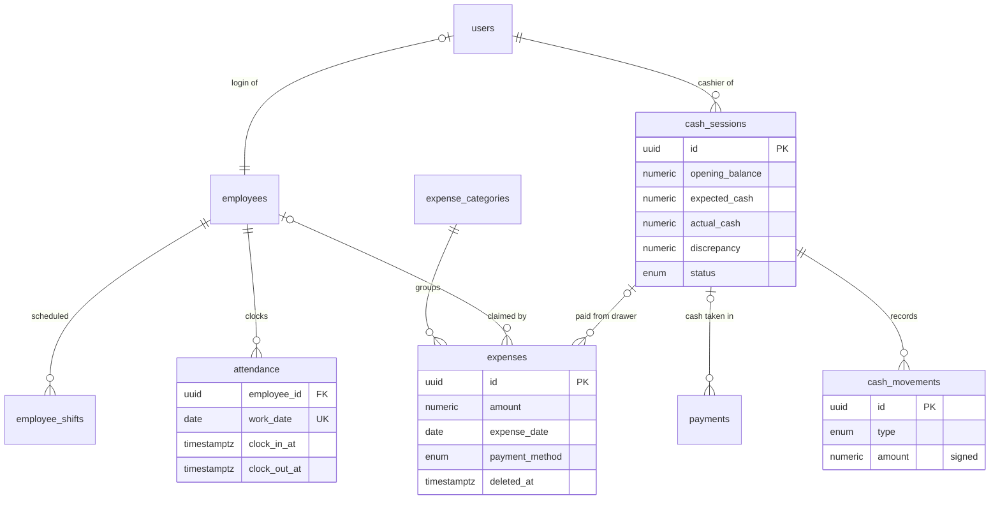

# RestaurantOS – Database design

PostgreSQL 16, managed with Prisma migrations. The canonical definition is
[`apps/api/prisma/schema.prisma`](../apps/api/prisma/schema.prisma) (64 tables); rules Prisma
cannot express live in
[`migrations/20261106040000_integrity_constraints`](../apps/api/prisma/migrations/20261106040000_integrity_constraints/migration.sql)
(check constraints, partial unique indexes, append-only and immutability triggers).

## Conventions

| Topic | Rule |
|---|---|
| Keys | UUID primary keys (`audit_logs` uses a bigint sequence for cheap ordered inserts). |
| Naming | snake_case tables and columns. |
| Tenancy | `organization_id` on every restaurant-owned row; `branch_id` where it belongs to an outlet. Branch-owned rows use a composite FK `(branch_id, organization_id) → branches (id, organization_id)`. Child rows (e.g. `order_items`) inherit tenancy through their parent. |
| Money | `NUMERIC(14,2)`; unit costs `NUMERIC(14,4)`; quantities `NUMERIC(14,3)`; rates `NUMERIC(6,3)`. |
| Time | `timestamptz(3)`; business dates (`expense_date`, `work_date`) are `date`. Default time zone Asia/Kolkata at the organization level. |
| Soft delete | Only for master data people may want back or that history points to: organizations, branches, users, tables, categories, products, ingredients, suppliers, employees, expenses. Transactions (orders, invoices, payments, movements) are never deleted; they are cancelled or reversed. |
| Concurrency | `version` columns on `orders`, `restaurant_tables`, `inventory_balances` for optimistic locking; row locks for sequences and balances inside transactions. |

## Entity-relationship diagrams

Split by domain for readability. Columns shown are the important ones; see the schema for all.

### Organization, access control and audit



### Menu and floor



### Orders, kitchen and billing



### Inventory and purchasing



### Finance and people



## Integrity rules enforced by PostgreSQL

| Area | Rule | Mechanism |
|---|---|---|
| Tenancy | A branch-owned row's branch is in the same organization | Composite FK to `branches (id, organization_id)` |
| Tenancy | A user's role belongs to the user's organization | Composite FKs on `user_roles` |
| Access | One assignment per (user, role, branch), with NULL = org-wide counted once | `UNIQUE … NULLS NOT DISTINCT` |
| Orders | Non-negative amounts, discount ≤ subtotal, round-off within ±1 | `orders_amounts_valid` |
| Orders | Cancelled orders and items carry a reason and the cancelling user | `*_cancel_reason_required` |
| Orders | Dine-in orders have a table session; order numbers unique per branch | check + unique |
| Tables | At most one open session per table | partial unique index |
| Invoices | Tax components sum to the tax total; CGST/SGST only intra-state, IGST only inter-state; paid ≤ total; refunded ≤ paid | `invoices_amounts_valid` |
| Invoices | One non-cancelled invoice per order; numbers unique per series and per organization | partial unique + unique |
| Invoices | Finalized invoices and their items cannot be changed or deleted (payment progress excepted) | triggers `invoices_guard_finalized`, `invoice_items_guard_finalized` |
| Payments | Positive amounts, idempotency key unique per organization | check + unique |
| Tax rates | CGST = SGST, CGST + SGST = rate, IGST = rate | `tax_rates_valid` |
| Stock | Movement sign matches its type; each business event deducts once | check + unique `dedupe_key` |
| Ledgers | `audit_logs`, `stock_movements`, `order_status_history`, `cash_movements` are append-only | `ros_forbid_mutation` trigger |
| Cash | One open shift per cashier per branch; a closed shift has expected, actual and discrepancy = actual − expected | partial unique + check |
| Formats | GSTIN, state code, HSN/SAC, lower-case email | checks |

These rules are covered by `apps/api/test/db-integrity.e2e-spec.ts`, which writes straight
through Prisma and expects PostgreSQL to refuse.

## Migrations and seeding

```bash
pnpm --filter @restaurant-os/api prisma:migrate        # prisma migrate deploy
pnpm --filter @restaurant-os/api db:seed               # permission catalog + units
SEED_DEMO=true pnpm --filter @restaurant-os/api db:seed  # + demo organization and users
```

CI also runs `prisma migrate diff` to prove the migrations and `schema.prisma` describe the same
database (no drift).

## Backups and restore

* Production: managed PostgreSQL with point-in-time recovery (WAL archiving), daily snapshots kept
  for 30 days, and a monthly restore drill into a scratch database.
* Self-hosted: `pg_dump -Fc` nightly to S3-compatible storage with lifecycle rules, plus WAL
  archiving (e.g. pgBackRest or WAL-G) for point-in-time recovery.

```bash
# backup
pg_dump --format=custom --no-owner --file=ros-$(date +%F).dump "$DATABASE_URL"
# restore into an empty database
pg_restore --no-owner --clean --if-exists --dbname="$RESTORE_DATABASE_URL" ros-YYYY-MM-DD.dump
```

Full runbooks are a Phase 8 deliverable.
